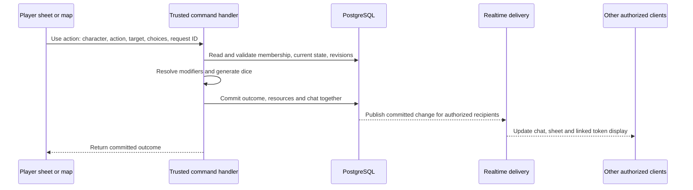

# WEIRS RPG: migration proposal

Date: 7 October 2026. Status: planning proposal, ready for review; no implementation or infrastructure provisioning is included.

## 1. Outcome and assumptions

Turn the current campaign tracker and compendium into an integrated virtual tabletop: persistent characters, homebrew rules, campaign records, chat and trustworthy dice rolls, uploaded assets, and maps with character-linked tokens. Preserve the existing Portuguese content, branding, and dark-and-gold visual identity.

Confirmed user constraints: personal use for eight people, stay on free tiers as long as possible, and Codex is the sole developer. Working assumptions: private, invitation-only campaigns; desktop/tablet play with mobile-friendly sheets and chat. Player location is unconfirmed; use São Paulo hosting if most players are in Brazil. Pricing below was checked against official sources on the proposal date, excludes taxes, optional domains, development labor, and usage beyond included allowances.

Success means the group can run a real session: open saved characters, select map targets, click attacks/spells, see authoritative results in chat, update shared HP/resources, and reconnect without losing committed state. Supporting homebrew means a complete editable sheet and extensible actions/resources; it does not require automatically implementing every exception in every class before launch.

The default architecture below is selected for these eight-person/free-tier constraints and one developer. Resolve campaign-specific rules when writing each implementation spec. Language choice should follow integration and maintenance needs rather than assumptions about a human development team's skills.

Codex owns implementation, import tooling, schema migrations, tests, integration checks, documentation, and deployment preparation. The group supplies campaign rulings and missing character information and validates the experience through actual play; no additional developer is assumed. Service accounts remain under the user's control. Prefer managed infrastructure and repeatable scripts so routine operation does not require a human developer or a permanent server administrator.

## 2. What exists and what can be reused

The repository is a static site, linked from its README to GitHub Pages. There is no package manifest, backend, database, account system, or build configuration. Its six JavaScript files implement navigation, tabs, filtering, modals, and a character simulator. Session storage remembers class tabs; character data is not persisted.

File/markup inventory, measured locally:

| Existing material | Observed amount | Migration approach |
| --- | --- | --- |
| HTML | 58 files, including indexes/test pages | Keep existing routes during migration; convert real content progressively |
| Spell cards | 477 `.carta-magia` elements | Import existing `data-*` fields and preserve descriptions/source citations |
| Feat cards | 199 `.card-talento` elements | Import categories, names, prerequisites, descriptions, links |
| Backgrounds | 61 `.card-antecedente` elements | Import categories and mechanics; resolve linked feats |
| Class details | 17 files, excluding index/test pages | Preserve lore and tables; curate mechanical definitions |
| Race details | 19 files, excluding index/test pages | Preserve custom species and traits; curate their mechanical effects |
| Campaigns | Othans, EPM, Taverna Jungle Jack | Import campaign records, session summaries, full modal text, character bios |
| Session cards | 16 across those campaign pages | Resolve each `data-modal` link to its complete session content |
| Character biography cards | 19 across those campaign pages | Import as incomplete character drafts; do not invent missing stats or accounts |
| CSS | 6 files plus inline page styles | Reuse tokens and visual patterns; isolate legacy styles |
| Local images | 16 files, 16,643,713 bytes total | Keep as static assets initially; catalog paths and hashes |

These are markup counts, not validated unique records or a guarantee that every item is finished. External images are additional assets, and test pages should not be silently imported as canonical content.

Specific reusable structure:

- `css/style.css` already has theme variables such as `--bg`, `--gold`, `--text`, and `--border-fantasy`, with Cinzel/Cinzel Decorative headings and Inter body text.
- Spell cards already carry Portuguese/original names, level, school, ritual, concentration, components, class lists, range, and casting time. Damage, saves, scaling, and resource effects still need curated machine-readable definitions.
- Backgrounds and feats already carry filter metadata. Class progression tables and subclass content provide source material, but not an executable rules engine.
- Campaign cards and their associated modals provide both short previews and full session narratives. Both must survive import.
- `javascript/simulador.js` provides a useful prototype for ability allocation, two roll sets, background bonuses, and HP choices. It mixes mechanics with DOM state and uses browser `Math.random()`. Extract and verify the intent, then implement pure calculations. Revalidate the fixed-HP-average formula and generic ASI schedule against the campaign's actual rules. Class selections currently use hit-die values rather than durable class IDs.
- `/WEIRS-RPG/` is hardcoded throughout navigation and assets. Introduce a configured base path and an old-URL mapping rather than breaking bookmarks and feat links.

## 3. Architecture choices and costs

### A. Recommended default: managed PostgreSQL and TypeScript

Use a React + TypeScript + Vite frontend; Supabase PostgreSQL, Auth, Realtime, and TypeScript Edge Functions; Supabase Storage initially; Cloudflare Pages for static hosting. Keep business rules in portable modules and database migrations in Git.

This is my recommendation for the eight-person group: target US$0 recurring infrastructure cost while staying inside the published free allowances. It builds on JavaScript, uses standard PostgreSQL, and provides accounts, storage permissions, and WebSocket delivery without operating a server. Edge Functions handle trusted HTTP commands; Supabase Realtime owns persistent client connections. Ordinary protected reads and simple CRUD can use row-level-security-controlled APIs directly.

Supabase Free currently includes a 500 MB database, 1 GB storage, 200 peak realtime connections, and 2 million realtime messages/month. It can pause after one inactive week and lacks automatic database backups. Stay on Free for personal play; check/resume the project before sessions after a break and maintain independent backups. Pro starts at US$25/month with compute credit covering one Micro instance and daily database backups, but it is an optional escape route rather than a planned requirement. [Supabase pricing](https://supabase.com/pricing).

Cloudflare Pages static requests are free; function invocations are separately metered. This proposal uses Supabase functions, so the frontend does not require a paid Workers subscription. [Pages pricing](https://developers.cloudflare.com/pages/functions/pricing/).

Start uploads in Supabase Storage because current local images are only about 16 MB, and existing static art need not be moved into paid storage. Add an S3-compatible storage adapter and switch new/large uploads to R2 if measured storage or bandwidth makes that worthwhile. R2 Standard includes 10 GB-month, 1 million write-class operations, and 10 million read-class operations monthly; excess storage costs US$0.015/GB-month and egress is free. Private R2 delivery still needs authorization through backend endpoints or signed requests. [R2 pricing](https://developers.cloudflare.com/r2/pricing/).

Expected eight-person infrastructure: US$0/month for ongoing quota-compliant personal use, accepting free-tier limits and project pausing. R2 is optional, not a mandatory extra provider on day one. Local development avoids paying for another always-on database project. Monitor usage before any paid upgrade; an account requiring a payment method for an optional service does not guarantee that its usage is free.

### B. Cheapest conventional always-on alternative: one VPS

Use the same frontend, a TypeScript Node backend with WebSockets, PostgreSQL, a reverse proxy with TLS, and R2 for uploaded files. A Rust backend can substitute if concrete requirements justify it. Run one application process initially, with one database; do not add Redis or separate chat/map services without evidence.

A reference entry-level Hetzner CX23 in Germany/Finland is currently €5.49/month excluding IPv4 and tax. Allow approximately €8–15/month for a small deployment including backup/network choices; this is a planning allowance rather than a quoted bundle. Region and instance availability matter. [Official current server prices](https://docs.hetzner.com/general/infrastructure-and-availability/price-adjustment/).

This can undercut managed production fees, but somebody must maintain security updates, deployments, authentication, database backups, monitoring, and recovery. A European server may have worse latency for Brazilian players; benchmark with the actual group before selecting it. A single server is an acceptable private-group compromise, with a single point of failure. Take database-aware offsite backups, not just live server-disk snapshots.

Choose this route only if the group accepts paid hosting and the operational burden, with scripts and an agreed maintenance routine. It is a weaker fit for the confirmed free-tier target and sole-developer setup. Do not adopt managed Supabase first with a planned immediate rewrite merely to save a small monthly amount; select the budget-compatible route before implementation.

### C. Low-bill managed alternative: Cloudflare-native

Use Workers for the API, D1 for relational data, SQLite-backed Durable Objects for authoritative room state and WebSockets, and R2 for assets. Static frontend hosting is free. Workers Paid starts at US$5/month, with product-specific allowances/overages; a small app might stay on Free. [Workers plans](https://www.cloudflare.com/plans/developer-platform/), [D1 pricing](https://developers.cloudflare.com/d1/platform/pricing/), [Durable Objects pricing](https://developers.cloudflare.com/durable-objects/platform/pricing/).

This is attractive if a very low recurring bill and managed operations outweigh development simplicity. Use WebSocket hibernation to avoid keeping rooms billable while idle. The extra work is selecting/integrating authentication and reconciling D1 records with Durable Object state. D1 is SQLite-based, so PostgreSQL JSONB, row-level-security policies, and SQL routines would need different implementations. This is a distinct starting architecture, not a cheap drop-in hosting change for the Supabase plan.

### Decision

Pick A on its free tier for this group. Pick B only if the group later accepts a paid server and wants conventional portability with an operations owner. Pick C if free-tier pausing or measured realtime limits become a problem and the group accepts extra implementation work for a different managed architecture. Do not pay for infrastructure just because the app has eight concurrent users.

## 4. Rust's role

Rust with Axum/Tokio is a sound HTTP/WebSocket backend choice; Axum explicitly supports WebSocket extraction and upgrades. [Axum WebSocket documentation](https://docs.rs/axum/latest/axum/extract/ws/index.html).

However, the hard parts here are homebrew modeling, permissions, transactional state changes, and collaborative map behavior. A small campaign's chat traffic is not a compelling performance reason to introduce a second programming language. TypeScript also lets browser previews and authoritative server calculations share a rules package.

With Codex as the sole developer, choose TypeScript initially to share rules and contracts between the browser and backend and keep the deployment simple. Rust remains available if profiling or concrete deployment requirements justify it; writing Rust is not the limiting factor, but a second runtime, deployment surface, and rules implementation add work to maintain. If a later decision selects Rust, use one Rust service, generate frontend types from its API schema, and verify shared rules fixtures while keeping authoritative calculations on the server. Do not make chat a separate Rust microservice during the first release.

## 5. Recommended system boundaries

One application repository, with clear modules:

```text
apps/web/                 React UI: compendium, campaigns, sheets, chat, tabletop
packages/rules/           Pure calculations, action definitions, dice parser
packages/contracts/       Validated commands, events, persisted schema versions
packages/theme/           Existing visual tokens and reusable UI styles
tools/content-import/     Repeatable HTML extraction and review reports
content/                  Versioned seeds/source snapshots and source manifest
supabase/migrations/      Schema, policies, transactional routines
supabase/functions/       Trusted commands and private upload/download endpoints
public/legacy/            Preserved pages/assets during gradual migration
```

This is a proposed layout; use an equivalent simple workspace without unnecessary build orchestration. On the VPS route, replace Supabase functions with one `apps/server` and explicit authorization at every API/WebSocket boundary.

Keep compendium and narrative browsing usable alongside the play workspace. The workspace contains a map, chat, and character inspector; responsive layouts can use tabs/drawers on narrow screens. Use the existing typography and colors for chrome, cards, badges, and links; use readable Inter text and compact spacing for live sheets rather than forcing long-form page spacing into every control.

Scope old global CSS to legacy content; in particular, global body layout, padding, and header positioning should not constrain the tabletop viewport. Extract inline styles when a page becomes a component, rather than rewriting all CSS in advance. Preserve original routes or redirect them to an explicit mapping. Query parameters and hash links must still resolve.

## 6. Data model and content migration

Use relational tables for ownership, identity, and relationships; JSONB for bounded, schema-validated homebrew payloads and descriptive structure.

| Group | Principal records | Purpose |
| --- | --- | --- |
| Identity | profiles, campaigns, campaign_members, invitations | Owners, GMs, players, spectators, membership |
| Compendium | content_entries, content_revisions, rulesets, ruleset_entries | Versioned spells/classes/species/feats/items/features and campaign-selected rules |
| Characters | characters, character_classes, character_grants, character_items, character_actions, character_resources, character_effects | Multiclass levels, selections, inventory, rollable actions, counters, temporary effects |
| Narrative | journal_entries, campaign_sessions | World lore, bios, session recaps, GM notes, visibility |
| Tabletop | scenes, scene_tokens, encounters, combatants | Grid settings, token placements, initiative and encounter state |
| Communications | messages, message_recipients, action_results | Durable chat, whispers, roll breakdowns and linked action outcomes |
| Files | assets, asset_links | Storage keys, MIME/size/hash, permissions, references |
| Consistency | command_receipts | Idempotency keys and committed outcomes for retries |

Every campaign-owned record must be protected through verified campaign membership. Token ownership must be explicit; a token references a character, but position/visibility belongs to the scene. Do not store a second independent copy of character HP in the token. Treat current character inputs/resources as canonical; derive bonuses and display summaries instead of maintaining many editable copies.

Content records need stable IDs, human-readable slugs, language, source, source URL/page/path, edition/ruleset, visibility, revision, and description. Do not equate the README's D&D 2024 claim with proof that all 477 spells use the same rules version. Import unknown versions as unreviewed and resolve them before automation. Portuguese and English names should refer to one entry, not independent records.

Characters pin granted features and action definitions to specific content revisions. A homebrew edit creates a revision and offers an explicit character migration; it does not silently change existing characters or historical rolls. Distinguish original imports, editable compendium revisions, and character-specific overrides so later imports cannot overwrite user edits.

Import sequence:

1. Capture the Git revision and a source manifest. Inventory every canonical page, asset, link, test page, and remote image URL. Preserve the original repository content.
2. Parse HTML with a real HTML parser such as Cheerio, using per-content-type selectors. Regex is suitable for the initial inventory, not nested-description extraction.
3. Extract structured metadata and sanitized rich-text descriptions. Preserve ordered lists, tables, full modal narratives, source citations, accented names, and old anchors. Parse campaign dates as Brazilian day/month/year dates; store session dates separately from event timestamps.
4. Emit deterministic, versioned seed records and a report of duplicate names, ambiguous sources, missing links, unresolved class/species references, and unsupported mechanics. IDs should come from a stable source mapping, not array order or a name that can change.
5. Resolve links using an explicit mapping, including spell class lists and background-to-feat relationships. Import character bios as drafts; associate real users by invitation, never by guessing from player names in a title.
6. Run an idempotent importer using source identity/checksums. Re-running the same import creates no duplicates and does not overwrite edited records. Keep semantic changes reviewable.
7. Compare import totals and rendered representative records with the source pages. Pilot one campaign first, while retaining all compendium content.

Preserve descriptions even when their mechanics are not yet automated. Human review is required for damage formulas, saves, scaling, prerequisites, progression tables, and custom exceptions. Do not automatically transform arbitrary prose into trusted executable rules.

The repository contains PHB citations, UA/third-party material, and translated content. Store source/license metadata now. For a future public compendium, publish material with appropriate permission; the official SRD is the documented Creative Commons baseline, not every item from a referenced rulebook or website. This is a public-release dependency to resolve, not a reason to delete the existing campaign data. [Official SRD and license](https://www.dndbeyond.com/srd/).

## 7. Character sheets and homebrew

Separate sheet completeness from automation coverage. A complete editable sheet should cover identity/bio, species/background, multiple classes/subclasses and levels, six abilities, proficiency bonus, saves/skills with expertise, AC/initiative/speeds, HP/temp HP/hit dice/death saves, attacks, equipment/currency/attunement, spellcasting/preparation/slots, features, conditions, and short/long-rest resources. Allow explicit custom fields, actions, counters, and labeled overrides so a rule exception cannot prevent play.

Use structured, typed definitions for common mechanics: an additive modifier, a proficiency/expertise grant, an AC formula, a resource with a reset rule, a rollable attack, a save-based spell, damage/healing components, and level-based scaling. Restrict formulas to an allowlisted expression grammar. Homebrew editors configure these primitives; they cannot execute arbitrary JavaScript or server code.

Track effect source and show a calculation explanation, for example base ability modifier + proficiency + item bonus + temporary effect. Define stacking behavior and override precedence rather than repeatedly adding the same feature after every save. Preserve custom resources such as class-specific points without adding a new database column for each class.

Initially automate the actual group's characters and common rules, while keeping the remaining content readable and manually usable. Add subclass-specific automation in verified batches. Keep multiclass representation from day one even if the first character-creation wizard has limited automatic choices; existing biographies already include multiclass characters.

## 8. One action flow joins sheets, maps, and chat

All three interfaces reference the same character/action/target identities. A sheet click submits an action command; it does not send a client-chosen die result.



The handler validates character ownership, campaign/scene membership, allowed targets, action revision, and resource availability. Derive bonuses from authoritative character state. Allow declared situational modifiers according to campaign policy, with an explanation in the roll card. Use a cryptographically secure random source, a bounded dice parser, and limits on expression size/dice count. Support standard expressions, advantage/disadvantage, and keep/drop syntax such as `4d6kh3`.

Roll cards retain individual dice, expression, modifiers, action label, actor, target, timestamp, chosen options, and rules revision. Store public and private results with actual access controls. Whisper/GM roll payloads must never be sent to the public room and merely hidden in the UI.

Resource consumption, result insertion, and the corresponding message must commit together in a database transaction. On Supabase, an Edge Function can prepare a result and invoke a restricted transactional database routine. Use a unique command receipt plus row locks/version checks: concurrent use of the final slot cannot both succeed. A retry returns the saved outcome rather than consuming twice or rolling again. Failed validation commits nothing.

An attack roll is not automatically a hit: offer separate damage rolls and GM-authorized Apply Damage/Healing, including target saves, resistances, temp HP, and effects as coverage grows. Default to explicit application for complex rules. Update the character once, then derive token bars and sheet HP from that state. Log who applied or overrode an outcome, and permit a controlled undo/correction rather than altering the recorded dice.

## 9. Realtime, reliability, and permission boundaries

Use one campaign/session connection with authorized channels. Durable chat messages, roll outcomes, HP/resources, final token positions, and initiative are stored in PostgreSQL; online status, typing indicators, cursors, and optional drag previews are transient. Broadcast is delivery, not a substitute for a durable record.

Make saved changes authoritative. Clients can preview their own drag immediately, but only a validated final move becomes durable. Restrict token control to the GM and assigned players. Handle stale character/token versions with a recoverable conflict, not an entire stale sheet overwriting another user's changes. GM layer/token secrecy requires filtering database reads, snapshots, events, and asset access, not just concealing canvas elements.

Reconnect by subscribing, loading an authorized snapshot, and reconciling buffered changes by record versions. Fetch missed chat with a stable pagination cursor and de-duplicate by event/message ID. Refetch state when a gap is detected. Display connection status; trusted rolls/resource spending require a server acknowledgement. Sheets can retain local drafts, but should surface conflicts before syncing them.

For Supabase, use campaign-aware row-level security plus explicit authorization for private Realtime channels; function/service credentials stay server-side, and trusted command tables are not freely writable by clients. Avoid arbitrary public client broadcasts being accepted as official roll results. [Realtime authorization](https://supabase.com/docs/guides/realtime/authorization).

Message fan-out matters for cost: Supabase counts Broadcast sending plus each receiving subscriber. With one continuously active sender at 10 updates/second, seven recipients, and sixteen play hours/month, previews alone would produce 4,608,000 counted messages, exceeding Free; actual intermittent movement is usually much lower. At one update/second the same example is 460,800 messages, but multiple simultaneous senders multiply it. Default to local dragging plus broadcast of committed final moves. Suppress high-frequency cursor updates and introduce throttled previews only if measured usefulness fits the budget. A reasonable initial warning threshold is 50% of the monthly allowance so the group can reduce optional traffic early. [Realtime usage accounting](https://supabase.com/docs/guides/platform/manage-your-usage/realtime-messages).

## 10. Maps and assets

Use Konva/react-konva as the initial Canvas 2D renderer for background images, grid overlays, draggable/selectable tokens, pan/zoom, measurements, and simple drawings. It integrates canvas graphics with React components. Validate performance with representative scenes before considering a WebGL renderer. [react-konva documentation](https://konvajs.org/docs/react/index.html).

First playable tabletop scope:

- Upload/choose a background; calibrate square-grid cell size, origin, and distance units. Persist token world coordinates independently of screen zoom, with token size measured in grid cells.
- GM creates scenes, places/hides tokens, sets ownership, and chooses the active scene.
- Players move owned tokens; everyone receives allowed committed changes.
- Tokens reference PCs or NPCs, support conditions and HP bars with configurable visibility, and open the linked sheet/action list.
- Select targets for actions; click initiative from the sheet and add the actor to an encounter tracker.
- Add manual reveal/hide or GM-painted fog after basic synchronization works. Withhold hidden entities and private assets from player payloads. A fog overlay alone cannot keep an already-downloaded background secret; document that limitation or implement server-controlled reveals/tiles when secrecy requires it.

Later enhancements: hex grids, area templates, terrain/walls, dynamic lighting and per-token vision, advanced drawing, and automation of complex effects. Dynamic lighting should be a dedicated later project because it combines geometry, visibility, rendering performance, and permissions. Reusing the existing world-map art does not provide calibrated battle grids; treat atlas pages and battle scenes as different uses of an asset.

Store bytes in object storage and metadata/relationships in the DB. Existing logos/fonts/theme assets can remain static. Use a private bucket by default for uploaded campaign maps and handouts. Authorize upload/download, enforce file/MIME/dimension/size quotas, sanitize textual content, and render untrusted files safely. Give browsers only user-scoped or short-lived signed upload permissions, never privileged storage credentials. Catalog remote art; replace unstable hotlinks with hosted copies only where permission allows.

Generate small thumbnails and sensible map resolutions, cache immutable approved assets, and avoid retransmitting image bytes over WebSockets. For the free deployment, initially cap an uploaded map at 10 MB, tokens at 1 MB, and warn at 700 MB total stored assets; refine limits after sampling real maps. Compress maps to a suitable WebP/JPEG resolution and keep originals in the group's existing local/cloud archive rather than duplicating every original in app storage. Size limits are app choices, not vendor limits. Cached/uncached bandwidth allowances also matter: a 10 MB map downloaded once by eight people transfers about 80 MB before protocol overhead, and frequent reloads increase that. Keep storage keys independent of providers/temporary signed URLs. Start with images and handouts; use existing voice/video tools during play rather than building streaming infrastructure.

## 11. Delivery sequence and acceptance criteria

Delivery is tracked through completed, verified milestones for Codex as the sole developer. The previous human developer-week estimate is withdrawn: it does not predict agent execution time or the number of working sessions. Refine estimates from the first implemented slice and its actual import, rules, and testing complexity. Exhaustive automation of every imported feature and Roll20-level feature parity remain separate expansions.

| Phase | Work | Exit condition |
| --- | --- | --- |
| 1. Preserve and structure | Content manifest/importer, source/revision metadata, theme extraction, frontend shell and old-route mapping | Counts reconciled, representative content and narrative links match, repeated import is safe |
| 2. Persist campaign play | Auth/invites/roles, DB policies, campaign journals, private assets, editable complete sheet structure | Two accounts can save/reopen characters; access isolation and exports work |
| 3. Integrated sheet/chat slice | Authoritative dice/actions, durable chat/whispers, resources, rests, actual group's essential automation | Sheet attack reaches chat; slot use is atomic; duplicate/reconnect paths are verified |
| 4. Playable tabletop | Scenes/grid/pan/zoom/tokens/ownership, character links, targeting, shared HP and initiative | Group completes a mock encounter with two browsers and reconnects correctly |
| 5. Session hardening | Import remaining campaign records, fill real-character rule gaps, fog/visibility needs, restore checks, group playtest | Run a complete real campaign session without returning to a different tool for core flows |

Work sequentially through small, reviewable changes with reusable test fixtures. Codex performs content extraction and mechanical curation from the supplied sources; ambiguous homebrew rulings need the group's decisions, not another developer. All narrative content and descriptions can be imported early; automated support grows according to actual characters and encounters. Preserve a runnable checkpoint at each milestone so the group can use and assess progress before the whole VTT is finished.

Build the shared action model before the tabletop UI, then use a single PC/NPC and a simple scene as the integration proof. Do not finish every subsystem independently before testing sheet → action → chat → resource → token behavior. Keep the current site usable during migration; remove legacy copies only after each new route passes content and link checks.

Important verification:

- Import counts/checksums, accented text, full modal bodies, tables, source links, duplicates, and stable old anchors.
- Rules fixtures for the group's homebrew, multiclass proficiency/progression, HP, expertise, modifiers, advantage/disadvantage, rest resets, and manual override precedence.
- Command tests for simultaneous last-resource use, duplicate requests, invalid targets, stale versions, and failure before/after commit.
- Permission tests with two campaign users, a GM, and an outsider, covering whispers, hidden tokens, private files, and channel authorization.
- Two-browser end-to-end play: save sheet, cast from sheet, see chat, select target, apply damage, see matching token HP, drag token, disconnect/rejoin, recover the same state.
- Representative map/image load and rendering measurements; track real message/egress/storage usage during a mock session before picking higher quotas or adding previews.

## 12. Operational costs and release boundaries

For the default managed route, monitor DB size, assets, realtime messages/connections, and function use; set application upload limits and review billing alerts. Keep hosted compendium descriptions cached/static where practical, while database revisions remain authoritative for editable content. Avoid loading the current 1.5 MB spell HTML into every play screen; load paginated metadata and fetch details on demand.

Choose a DB region near the players. Supabase offers a São Paulo region; confirm availability when provisioning. [Available regions](https://supabase.com/docs/guides/platform/regions).

Use an OAuth provider that suits the group, or configure production SMTP if using email sign-in. Supabase's default email service has restrictions and should not be assumed to support ordinary production invitations. [SMTP guidance](https://supabase.com/docs/guides/auth/auth-smtp).

Back up both PostgreSQL and the actual file objects. Database backups do not include Supabase Storage file contents. Export campaign/character data in a versioned portable format and maintain a separate asset-copy/manifest process. Provide a backup script runnable on an existing computer, with a scheduled daily run when that computer is available and a backup after each session; no always-on paid backup server is needed. Target no more than one day of data loss when daily backups run, and disclose longer gaps if the computer is offline. Prove that a restore can recover one campaign and its assets. Keep at least one backup copy independent of the live app account. [Database backup documentation](https://supabase.com/docs/guides/platform/backups).

Do not start with Kubernetes, microservices, Redis, GraphQL, CRDTs for the entire app, live voice/video, 3D dice, or a generic plugin execution platform. These do not help prove the core campaign workflow. Add infrastructure only for a measured need.

Public sign-ups, billing, and marketplace/community features are outside this personal-use plan. Revisit operational and content publication requirements only if that scope changes.

## 13. Recommended first implementation brief

After the architecture/budget decision, the first project should be **content preservation and the persistent campaign foundation**: select one pilot campaign, build deterministic imports and the theme/app shell, introduce auth/membership and versioned data, and prove save/load/export with an editable character draft. Its spec should explicitly name the pilot PCs and homebrew rules, capture import/source decisions, and state its acceptance fixtures.

Follow with the authoritative sheet/chat action slice, then the tabletop. The desired long-term app is coherent, but these phases should receive separate detailed implementation specs/plans so Codex can verify each step and the group can review playable behavior before expanding the VTT feature set.
